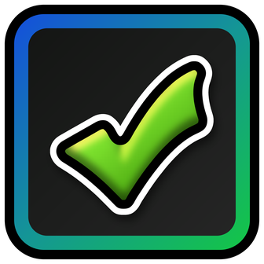

# Timmy Tracker

Your Geometry Dash progress, tracked live on [The Timmylist](https://www.timmylist.org).

## What it does

- **Live progress.** Your best % and completions on Timmylist levels are sent to your account as you play, so timmylist.org updates while you do.
- **Catch-up sync.** On launch (and from the pop-up) it sends the best % you already had, so nothing from before is lost.
- **Offline safe.** If you are offline, progress is saved and sent the next time the game is open.
- **Timmylist pop-up.** The Timmy Tracker logo on the main menu opens your whole list: a progress bar for the list, every level with your best % and a bar, completed count and points. Filter by All, To do and Done, and tap a level to open it.
- **Level page badge.** On a Timmylist level's page: its rank, points and your best. A button opens the level on timmylist.org.
- **In-level display.** Rank and your best % while you play, with position and opacity settings.
- **Replays.** Your clicks on Timmylist levels are recorded, and when you beat one the run is saved. Watch it again in the game from the level page or the green play button in the pop-up. Only your latest completion of each level is kept, and you can turn it off in the settings.
- **Notices.** First completions with the points earned, and optionally new bests.

## Setup

1. On timmylist.org open **Settings**, then **Connected Accounts**, then **Geometry Dash** and press **Link Geometry Dash**.
2. Copy the code and paste it into this mod's **Link code** setting.
3. Play. The pop-up shows who you are linked to.

Only levels on The Timmylist are sent. Practice mode and testmode are ignored. Keep your link code private.
